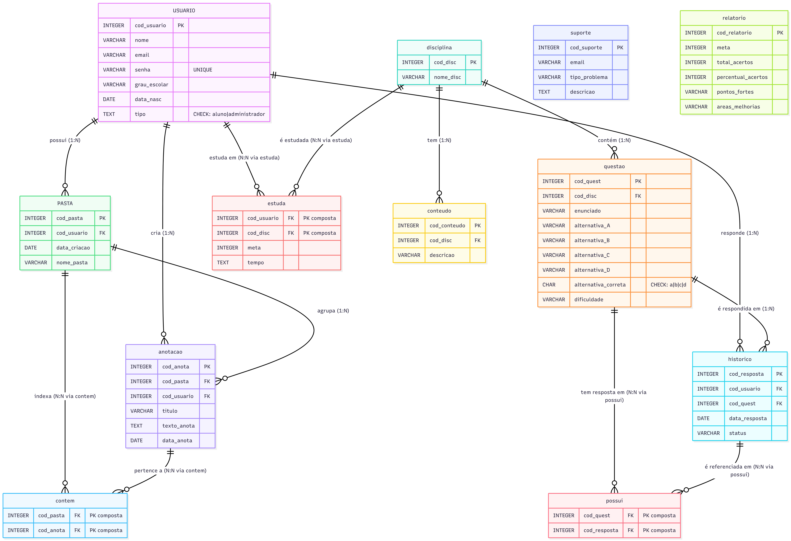

<div align="center">

# 🌟 LuminaSaber

### Plataforma web gamificada e gratuita de apoio ao aprendizado na educação básica

</div>

---

## 📖 1. Visão geral do sistema

**Objetivo do sistema:** o LuminaSaber é uma plataforma web destinada ao **apoio ao estudo de estudantes da educação básica** (do jardim de infância ao 9º ano), permitindo cadastro e login, resolução de questões de múltipla escolha, definição de metas de estudo, anotações organizadas em pastas, histórico de respostas e relatórios de desempenho com análise personalizada por IA.

**Público-alvo:** estudantes da educação básica que buscam praticar conteúdos por disciplina de forma gratuita e gamificada, e administradores responsáveis por cadastrar e manter o banco de questões e acompanhar os usuários.

**Principais funcionalidades:**
- **Autenticação de usuários** (JWT) com perfis de **aluno** e **administrador**, incluindo logout e recuperação de senha por e-mail;
- **Perfil com foto (upload de imagem)**: o usuário envia um avatar (JPEG, PNG ou GIF de até 2 MB), que é exibido no painel, no perfil e na lista de usuários do administrador;
- **Módulo de anotações**: criação de pastas, criação, edição e exclusão de anotações e exportação em PDF;
- Seleção de disciplina, tempo de estudo e meta de questões;
- Resolução de exercícios de múltipla escolha com busca e filtro por matéria;
- **Histórico** de respostas do aluno (acertou/errou);
- **Loja Estelar**: o aluno ganha Estrelas ao concluir sessões de estudo e as troca por benefícios (dicas, tempo extra, chance extra);
- Relatório de desempenho com pontos fortes e áreas de melhoria gerados por IA, citando exatamente os temas que o aluno acertou e errou;
- Área administrativa: CRUD completo de questões, lista de usuários com histórico e parâmetros do sistema.

O projeto foi originalmente desenvolvido para a disciplina de **Projeto Integrador**, já concluída, e atualmente segue em desenvolvimento como atividade da disciplina de **Linguagem e Técnicas de Programação II** do **Instituto Federal de Educação, Ciência e Tecnologia da Paraíba (IFPB)**, com foco na integração entre **front-end**, **back-end (Node.js/Express + TypeScript)** e **banco de dados relacional (SQLite)** via **Prisma ORM**.

### 👩‍💻 Equipe

| Nome | Matrícula |
|------|-----------|
| Walesca Amaro Rodrigues | 20241780019 |
| Rayssa Priscila Silva Nascimento | 20241780013 |

---

## ✨ Funcionalidades e telas

| Tela | Rota | Descrição | Acesso |
|------|------|-----------|--------|
| 🏠 Home | `/` | Apresentação da plataforma | Público |
| 📝 Cadastro de usuário | `/cadastro` | Formulário de cadastro (cria sempre um aluno) | Público |
| 🔐 Login | `/login` | Entrada com e-mail e senha (gera o token JWT) | Público |
| 🧭 Painel | `/painel` | Menu principal, saldo de Estrelas e avatar do usuário | Usuário |
| 🖼️ Meu perfil | `/perfil` | Dados do usuário e **upload da foto de perfil** | Usuário |
| 📚 Seleção de disciplinas | `/selecao` | Escolha da disciplina a ser estudada | Usuário |
| ⏱️ Definição de tempo | `/tempo` | Definição do tempo de estudo | Usuário |
| 🎯 Meta de questões | `/meta` | Definição da meta de questões a responder | Usuário |
| ✏️ Exercícios | `/exercicios` | Resolução das questões, com filtros e busca | Usuário |
| 🗒️ Anotações | `/anotacoes` | Pastas e anotações (criar, editar, excluir, exportar em PDF) | Usuário |
| 🕘 Histórico | `/historico` | Respostas anteriores do aluno | Usuário |
| ⭐ Loja Estelar | `/loja` | Troca de Estrelas por benefícios | Usuário |
| 📊 Relatório | `/relatorio` | Desempenho, pontos fortes/fracos e análise por IA | Usuário |
| ⚙️ Gerenciamento | `/admin` | Menu da área administrativa | Administrador |
| 👥 Usuários | `/admin-usuarios` | Lista de usuários (com foto) e histórico de cada um | Administrador |
| 🛠️ Parâmetros | `/admin-parametros` | Parâmetros do sistema | Administrador |
| ➕ Cadastro de exercícios | `/cadastro-exercicios` | CRUD completo de questões | Administrador |

---

## 🖥️ 2. Demonstração da interface (CRUD)

A tela **Cadastro de Exercícios** (`/cadastro-exercicios`) é a principal demonstração de integração CRUD do projeto, cobrindo as quatro operações sobre a tabela `questao`:

| Operação | Como é feita na interface | Rota da API |
|----------|---------------------------|-------------|
| **Create** | Formulário cadastra uma nova questão | `POST /api/questoes` |
| **Read** | Tabela lista todas as questões cadastradas | `GET /api/questoes` |
| **Update** | Botão "Editar" carrega os dados no formulário e salva as alterações | `PUT /api/questoes/:id` |
| **Delete** | Botão "Excluir" remove a questão, com confirmação prévia | `DELETE /api/questoes/:id` |

**Como ocorre a comunicação entre interface e banco de dados:** o front-end (HTML/JS puro, sem framework) usa a `Fetch API` do navegador para enviar requisições HTTP à API REST do Express. O `Controller` valida os dados recebidos e delega ao `Model`, que executa a operação no banco através do **Prisma Client**. A resposta (JSON) volta para o front-end, que atualiza a tabela na tela **sem precisar recarregar a página**.

```
Front-end (fetch)  →  Routes  →  Controllers (validação)  →  Models (Prisma)  →  SQLite
                                         ↓
                                  resposta JSON (200/201/400/404/409)
```

A tela de **Exercícios** (`/exercicios`) também demonstra a leitura (`Read`) do lado do aluno: as questões são buscadas via `GET /api/questoes`, filtradas por disciplina no próprio navegador, e cada resposta do aluno é exibida na hora (✅ acertou / ❌ errou, com a alternativa correta).

---

## 💾 3. Persistência dos dados

Os dados são armazenados em um arquivo físico de banco de dados SQLite (`backend/src/database/db.sqlite`), e **não em memória** — por isso permanecem salvos mesmo após reiniciar o servidor ou o computador.

**Como confirmar a persistência na prática:**

1. Cadastre uma questão pela tela `/cadastro-exercicios` (ou um usuário pela tela `/cadastro`);
2. Pare o servidor (`Ctrl+C` no terminal);
3. Inicie o servidor novamente (`npm run dev`);
4. Acesse `/cadastro-exercicios` (ou a listagem correspondente) — o registro cadastrado continua lá.

**Visualizando a tabela diretamente no banco**, sem precisar passar pela interface:

```bash
npx prisma studio
```

Esse comando abre uma interface visual no navegador (`http://localhost:5555`) com todas as tabelas do banco. Basta clicar em `Questao` ou `Usuario` para ver os registros salvos, mesmo com o servidor principal desligado — prova de que o dado foi de fato persistido no SQLite e não apenas mantido na memória da aplicação.

---

## 🧪 4. Testes de integridade

Os testes abaixo, presentes em [`backend/request.http`](backend/request.http) (extensão **REST Client** do VSCode), comprovam que o sistema rejeita dados inconsistentes antes de qualquer escrita no banco:

| Teste | Cenário | Resultado esperado |
|-------|---------|---------------------|
| Campos obrigatórios vazios | `POST /api/questoes` sem `enunciado` ou sem alternativas | `400 Bad Request` — lista os campos ausentes |
| Dado inválido | `alternativa_correta` fora de `a`, `b`, `c`, `d` | `400 Bad Request` |
| ID malformado | `GET/PUT/DELETE /api/questoes/abc` (não numérico) | `400 Bad Request` |
| Registro inexistente | `GET/PUT/DELETE` com um ID que não existe no banco | `404 Not Found` |
| Cadastro duplicado | Repetir a mesma questão já cadastrada | `409 Conflict` |
| Atualização parcial | `PUT` sem nenhum campo no corpo da requisição | `400 Bad Request` — "envie ao menos um campo" |
| Atualização válida | `PUT` com um ou mais campos válidos | `200 OK` — questão atualizada |
| Exclusão válida | `DELETE` de um ID existente | `200 OK` — confirma remoção |

**Como o sistema evita inconsistências:** toda validação acontece na camada de **Controller**, antes de qualquer chamada ao banco — nenhuma query é executada com dados inválidos. IDs são convertidos e checados com `Number.isNaN`; campos obrigatórios são verificados em lista fixa (`CAMPOS_OBRIGATORIOS`); a letra da alternativa correta é normalizada e validada contra um conjunto fechado (`a/b/c/d`); e duplicidade é tratada como erro de negócio (`409`), não como falha genérica. Erros nunca retornam silenciosamente — todos passam por uma classe `HttpError` central, capturada por um middleware (`errorHandler`) que padroniza a resposta JSON de erro.

---

## 🗄️ 5. Estrutura do banco de dados

A modelagem está em [`backend/prisma/schema.prisma`](backend/prisma/schema.prisma), com **16 models** representando as entidades do sistema, incluindo chaves primárias, chaves estrangeiras e relacionamentos 1:N e N:N.

<div align="center">
  
</div>

> Versão editável do diagrama (Mermaid): [`docs/erd.mmd`](docs/erd.mmd)

### Principais entidades

| Model | Descrição | Chave primária |
|-------|-----------|-----------------|
| `Usuario` | Alunos e administradores | `cod_usuario` |
| `Disciplina` | Matérias (Matemática, Português, etc.) | `cod_disc` |
| `Questao` | Questões de múltipla escolha (4 alternativas) | `cod_quest` |
| `Conteudo` | Tópicos/conteúdos de cada disciplina | `cod_conteudo` |
| `Pasta` | Pastas de anotações do usuário | `cod_pasta` |
| `Anotacao` | Anotações criadas pelo usuário | `cod_anota` |
| `Historico` | Registro de respostas (acertou/errou) | `cod_resposta` |
| `Relatorio` | Relatório de desempenho | `cod_relatorio` |
| `Suporte` | Solicitações de suporte/feedback | `cod_suporte` |
| `Estuda` | Associativa N:N entre `Usuario` e `Disciplina` (metas) | `cod_usuario` + `cod_disc` |
| `Contem` | Associativa N:N entre `Pasta` e `Anotacao` | `cod_pasta` + `cod_anota` |
| `Possui` | Associativa N:N entre `Questao` e `Historico` | `cod_quest` + `cod_resposta` |
| `Image` | Imagem de perfil do usuário (tabela `imagem_perfil`, relação **1:1** com `Usuario`) | `cod_imagem` (`cod_usuario` é `UNIQUE`) |
| `PasswordResetToken` | Tokens de recuperação de senha (guardados como hash, com validade) | `cod_token` |
| `Compra` | Compras de benefícios feitas na Loja Estelar | `cod_compra` |
| `InventarioBeneficio` | Saldo de benefícios comprados e ainda não usados | `cod_usuario` + `tipo` |

### Exemplos de relacionamento

- **1:N** — Uma `Disciplina` possui várias `Questao` (`Questao.cod_disc → Disciplina.cod_disc`).
- **1:N** — Um `Usuario` pode criar várias `Pasta` e `Anotacao`.
- **N:N** — Um `Usuario` "estuda" várias `Disciplina` (e vice-versa), modelado pela tabela `Estuda`, que guarda também a meta e o tempo de estudo.
- **1:1** — Um `Usuario` possui no máximo uma `Image` de perfil (`Image.cod_usuario` é `UNIQUE`, com `onDelete: Cascade`).
- **N:N** — Uma `Pasta` pode conter várias `Anotacao` (e uma anotação pode pertencer a mais de uma pasta), via `Contem`.


---

## 🧰 6. Documentação técnica

### Tecnologia utilizada

**Back-end:** Node.js + Express.js para o servidor HTTP e roteamento; TypeScript em modo `strict` para tipagem estática; **Zod** para validação de entrada; **jsonwebtoken** (JWT) e **argon2** para autenticação; **Multer** para upload de arquivos; **Nodemailer** para e-mails transacionais (boas-vindas e recuperação de senha); Morgan como logger de requisições; dotenv para variáveis de ambiente; tsx para execução de TypeScript sem build manual.

**Front-end:** HTML5 e CSS3 (responsivo via `@media queries`) e JavaScript puro consumindo a API REST via `Fetch API`, sem frameworks.

**Inteligência artificial:** a tela de relatório (`/relatorio`) usa a **API gratuita do Google Gemini** para gerar a análise de pontos fortes e áreas de melhoria. Em vez de frases genéricas fixas por matéria, o sistema envia ao modelo a lista real de questões que o aluno acertou e errou (enunciado, nível e alternativa escolhida) e recebe de volta um texto curto, em linguagem natural, citando exatamente os temas trabalhados — por exemplo, identificando que o aluno tem facilidade com fração e soma, mas dificuldade em potenciação. A chave de API é injetada pelo servidor a partir da variável `GEMINI_API_KEY` no `.env`, nunca exposta no código-fonte versionado.

**Segurança:** as senhas dos usuários são armazenadas com hash **Argon2id**, usando a biblioteca [`argon2`](https://www.npmjs.com/package/argon2) (`argon2.hash`/`argon2.verify`). Nunca é salva a senha em texto puro — ao cadastrar, a senha é hasheada antes de ir ao banco; ao autenticar, a verificação é feita com `argon2.verify`, que já compara o hash de forma segura internamente. A senha precisa ser forte (o cadastro exige, por exemplo, caractere especial — ex.: `SenhaForte@123`).

O cadastro público sempre cria usuários como **alunos**; o campo `tipo` enviado pelo cliente não concede privilégios administrativos. Administradores são provisionados pelo seed ou por uma operação administrativa controlada. O backend também valida formato de e-mail, nome e data de nascimento antes de acessar o banco. O `JWT_SECRET` é obrigatório e deve ter pelo menos 32 caracteres; copie `.env.example` para `.env` e substitua o valor de exemplo por um segredo aleatório (o arquivo `.env` nunca vai para o Git).

### Autenticação e proteção de rotas

O projeto possui um fluxo completo de autenticação por **JWT**. O cadastro é feito em `POST /api/usuarios` e o login em `POST /api/usuarios/login`. Quando o usuário faz login com e-mail e senha válidos, o backend gera um token com `jsonwebtoken` e o retorna no corpo da resposta. Esse token deve ser enviado no header `Authorization: Bearer <token>` em rotas privadas. O front-end guarda o token e o envia pelo helper `fetchAutenticado` (`public/js/auth.js`); se o servidor responder `401`, a sessão é limpa e o usuário volta para o login.

A proteção é realizada por middlewares (`src/middlewares`):

- `authMiddleware`: valida o token, identifica o usuário autenticado e injeta os dados no `req.user`. Token ausente, inválido ou expirado resulta em `401 Unauthorized`, com mensagem padronizada pela classe `HttpError`;
- `adminMiddleware`: libera a rota apenas para o perfil **administrador** (`403` para os demais);
- `authPageMiddleware` e `blockDirectHtmlAccess`: protegem as **páginas** privadas e administrativas, redirecionando para `/login` quando não há sessão.

### Banco de dados empregado

**SQLite**, banco relacional leve armazenado em um único arquivo local (`backend/src/database/db.sqlite`), adequado para o escopo do projeto por não exigir servidor de banco separado.

### Estrutura de persistência

**Prisma ORM** é responsável por três frentes: (1) a **modelagem**, definida declarativamente em `schema.prisma`; (2) as **migrations**, versionadas em `prisma/migrations`, que criam e atualizam as tabelas no SQLite de forma reproduzível em qualquer ambiente; e (3) o **seed** (`src/database/seed.ts`), que popula o banco com dados iniciais de teste usando `INSERT OR IGNORE`, evitando duplicação ao rodar mais de uma vez.

### Forma como os dados são manipulados

O back-end segue o padrão **MVC** adaptado para API REST, com uma camada de **services** para regras que vão além do acesso ao banco (como o upload de arquivos):

```
Requisição HTTP
      │
      ▼
┌─────────────┐
│ Middlewares │  → autenticação, autorização, validação (Zod) e upload (Multer)
└─────┬───────┘
      ▼
┌─────────────┐
│   Routes    │  → define os endpoints (ex: GET /api/questoes)
└─────┬───────┘
      ▼
┌─────────────┐
│ Controllers │  → recebem a requisição, definem o status HTTP da resposta
└─────┬───────┘
      ▼
┌─────────────┐
│  Services   │  → regras de negócio (ex: gravar/validar o arquivo de imagem)
└─────┬───────┘
      ▼
┌─────────────┐
│   Models    │  → centraliza o acesso ao banco usando o Prisma Client
└─────┬───────┘
      ▼
┌─────────────┐
│   SQLite    │  → banco de dados relacional
└─────────────┘
```

- **Routes** (`backend/src/routes`): mapeiam URLs para funções dos controllers e definem **a ordem dos middlewares** em cada rota.
- **Controllers** (`backend/src/controllers`): recebem `Request`/`Response` e retornam JSON com os códigos HTTP corretos (`200`, `201`, `400`, `401`, `403`, `404`, `409`).
- **Services** (`backend/src/services`): regras de negócio isoladas dos controllers (`profileImageService.ts`, `SendMail.ts`).
- **Models** (`backend/src/models`): concentram todas as chamadas ao Prisma Client — nenhuma query aparece nos controllers.
- **Schemas** (`backend/src/schemas`): esquemas Zod que validam corpo, parâmetros e query antes de o controller ser executado.
- **Erros**: a classe `HttpError` (`backend/src/errors`) representa erros com status HTTP, capturados de forma centralizada pelo middleware `errorHandler`, que também traduz os erros do Multer (tamanho excedido) em respostas `400`.

---

## 🖼️ 7. Upload de imagem de perfil

O usuário autenticado envia uma foto de perfil, que é salva no servidor, associada ao seu registro no banco e exibida nas telas do sistema.

### Caminho do arquivo (do formulário ao banco)

```
perfil.html (input file + FormData + fetch com Bearer)
      │
      ▼
POST/PUT /api/users/image
      │
      ├─► authMiddleware      → sem token válido: 401 (o arquivo nem é processado)
      │
      ├─► uploadImage (Multer)
      │       • fileFilter: só image/jpeg, image/png, image/gif → senão 400 (nada gravado)
      │       • limite de 2 MB → senão 400 (arquivo parcial é descartado)
      │       • diskStorage: grava em backend/uploads/<uuid>.<ext> (nome gerado pelo servidor)
      │
      ├─► ProfileImageController → exige o arquivo no campo "image" (senão 400)
      │
      ├─► ProfileImageService
      │       • confere os bytes reais do arquivo (assinatura JPEG/PNG/GIF) → senão apaga e responde 400
      │       • salva o caminho no banco e remove a imagem anterior do disco
      │
      └─► ImageModel (Prisma) → upsert na tabela imagem_perfil (1 registro por usuário)
              │
              ▼
        201 (primeiro envio) ou 200 (substituição) com { "imageUrl": "/uploads/<uuid>.png" }
```

### Decisões de segurança e projeto

| Aspecto | Como foi feito |
|---------|----------------|
| Configuração do Multer | `backend/src/middlewares/uploadImage.ts`: `diskStorage` com destino `backend/uploads/`, limite de **2 MB** e `files: 1` |
| Nome do arquivo | Gerado pelo servidor (`crypto.randomUUID()` + extensão escolhida pelo servidor). O `originalname` do cliente é **ignorado**: não há sobrescrita nem caminho malicioso (`../`) |
| Tipos permitidos | Lista de permissões: `image/jpeg`, `image/png`, `image/gif` |
| Arquivo recusado | O `fileFilter` roda **antes** do armazenamento: responde `400` e **nada é gravado em disco**. Se o limite de tamanho for excedido, o Multer apaga o arquivo parcial |
| Conteúdo falso | O MIME vem do cliente e pode mentir. O serviço lê os primeiros bytes do arquivo e confere a assinatura real; se não bater, apaga o arquivo e responde `400` |
| Rotas protegidas | `authMiddleware` executa **antes** do Multer: sem token, `401` sem processar o arquivo |
| Um arquivo por usuário | `cod_usuario` é `UNIQUE` em `imagem_perfil` e o model usa `upsert`: um novo envio **atualiza** o caminho (e apaga a imagem antiga), sem criar um segundo registro |
| Remoção segura | Só são apagados arquivos com o formato exato gerado pelo servidor (`<uuid v4>.jpg\|png\|gif`) |
| Erros | Centralizados no `errorHandler`: `HttpError` e `MulterError` (`LIMIT_FILE_SIZE`) viram `400` com mensagem clara |

### Persistência

Model `Image` em `backend/prisma/schema.prisma` (tabela `imagem_perfil`), com relação **1:1** com `Usuario`:

```prisma
model Image {
  cod_imagem    Int      @id @default(autoincrement())
  cod_usuario   Int      @unique
  caminho       String
  criado_em     DateTime @default(now())
  atualizado_em DateTime @updatedAt

  usuario Usuario @relation(fields: [cod_usuario], references: [cod_usuario], onDelete: Cascade)

  @@map("imagem_perfil")
}
```

A migration correspondente é `prisma/migrations/20261020120000_user_profile_image` e é aplicada pelo mesmo `npx prisma migrate dev` do passo a passo.

### Arquivos estáticos e controle de versão

- A pasta `backend/uploads/` é servida como conteúdo estático em `/uploads` (`server.ts`, com `express.static`, `dotfiles: 'deny'` e sem listagem de diretório).
- O `.gitignore` ignora os arquivos enviados, mas **mantém a pasta** por meio do `uploads/.gitkeep`, para a aplicação subir do zero após um `git clone`:

```gitignore
/backend/uploads/*
!/backend/uploads/.gitkeep
```

### Front-end

- **Formulário** em `public/perfil.html`: `<input type="file" accept="image/jpeg,image/png,image/gif">`.
- **Envio** com `FormData` e `fetch`, **sem definir `Content-Type` manualmente** (o navegador monta o `multipart/form-data` com o boundary correto). O token entra no header `Authorization: Bearer` pelo `fetchAutenticado`. Usa `POST` no primeiro envio e `PUT` nos seguintes.
- **Pré-visualização** local da imagem escolhida (`URL.createObjectURL`) antes de enviar.
- **Erros** de tipo e de tamanho são mostrados ao usuário (validação no cliente para melhor experiência e, principalmente, a resposta `400` do servidor).
- **Uso do arquivo nas demais telas**: o avatar aparece no cabeçalho do **painel** (`/painel`), no **perfil** (`/perfil`) e na **lista de usuários** do administrador (`/admin-usuarios`). O helper `public/js/avatar.js` mostra a foto ou, se não houver (ou se falhar ao carregar), as iniciais do nome. A rota `GET /api/usuarios/perfil` devolve o `imageUrl` do usuário.

---

## 📁 Estrutura de pastas

```
LuminaSaber/
├── public/                          # Front-end (estático)
│   ├── home.html, login.html, cadastro.html
│   ├── painel.html                  # Menu principal (com avatar do usuário)
│   ├── perfil.html                  # Perfil + upload da foto
│   ├── anotacoes.html               # Pastas e anotações (exporta PDF)
│   ├── historico.html, loja.html, relatorio.html
│   ├── seleção_disciplinas.html, defina_seu_tempo.html, meta_questoes.html
│   ├── admin.html, admin-usuarios.html, admin-parametros.html
│   ├── cadastro_exercicios.html     # CRUD de questões (admin)
│   ├── css/avatar.css               # Estilo do avatar
│   ├── js/                          # auth.js, avatar.js, estrelas.js, loja.js, tema.js
│   ├── img/
│   └── tela_exercicios/
│       ├── exercicios.html
│       ├── css/style.css
│       └── js/ (main.js, filtros.js, carregarQuestoes.js)
│
├── backend/                          # Aplicação Node.js/Express
│   ├── server.ts                     # Ponto de entrada (inclui o /uploads estático)
│   ├── prisma.config.ts              # Configuração do Prisma (schema, migrations, seed)
│   ├── .env.example                  # Modelo de variáveis de ambiente
│   ├── .gitignore
│   ├── package.json
│   ├── tsconfig.json
│   ├── request.http                  # Testes da API (REST Client)
│   ├── upload.http                   # Testes das rotas de upload (REST Client)
│   ├── scripts/gerar-arquivos-teste.mjs  # Gera os arquivos de teste do upload
│   ├── test-files/                   # Arquivos usados no upload.http
│   ├── uploads/                      # Imagens enviadas (conteúdo ignorado; .gitkeep versionado)
│   ├── data/questoes.json            # Base de questões usada no seed
│   ├── prisma/
│   │   ├── schema.prisma             # Models, PKs, FKs e relacionamentos
│   │   └── migrations/               # Histórico de migrations do Prisma
│   └── src/
│       ├── routes/                   # Endpoints REST e rotas de páginas
│       ├── controllers/              # Recebem a requisição e definem a resposta HTTP
│       ├── services/                 # Regras de negócio (profileImageService, SendMail)
│       ├── models/                   # Acesso ao banco via Prisma Client
│       ├── schemas/                  # Validação de entrada (Zod)
│       ├── lib/                      # prisma, auth (JWT), crypto/password (argon2), uploadPaths
│       ├── middlewares/              # auth, admin, validate, uploadImage, errorHandler, ...
│       ├── errors/HttpError.ts       # Classe de erro HTTP customizada
│       ├── config/mail.ts            # Configuração de e-mail (SMTP/Ethereal)
│       ├── database/                 # Conexão, migration (SQL bruto) e seed
│       ├── types/                    # Tipos TypeScript compartilhados
│       └── __tests__/                # Testes automatizados
│
├── docs/
│   ├── erd.mmd                       # Diagrama ER (Mermaid)
│   ├── erd.png                       # Diagrama ER renderizado
│   ├── PI - Template Especificação Projeto.docx
│   └── Protótipo_telas_LuminaSaber.pdf
│
├── .gitignore
└── README.md
```

---

## ⚙️ Como executar o projeto

### Pré-requisitos

- [Node.js](https://nodejs.org/) (recomendado: versão 22 ou superior)
- [Git](https://git-scm.com/)
- Uma chave gratuita da [API do Google Gemini](https://aistudio.google.com/) (apenas para a análise de IA no relatório)
- Extensão **REST Client** no VSCode (para os testes da API)

### Passo a passo

```bash
# 1. Clone o repositório
git clone https://github.com/walescaamaro/LuminaSaber.git
cd LuminaSaber

# 2. Acesse a pasta do backend (toda a aplicação fica aqui)
cd backend

# 3. Instale as dependências
npm install

# 4. Crie o arquivo de variáveis de ambiente
cp .env.example .env
# Edite o .env:
#   JWT_SECRET  → obrigatório, texto aleatório com no mínimo 32 caracteres
#                 (gere com: openssl rand -hex 32)
#   GEMINI_API_KEY → sua chave (só necessária para a análise de IA)

# 5. Gere o Prisma Client
npm run prisma:generate

# 6. Crie/atualize as tabelas do banco de dados (Prisma Migrate)
# Como o repositório já traz as migrations (inclusive a da imagem de perfil),
# este comando apenas as aplica ao seu banco local:
npx prisma migrate dev

# 7. Popule o banco com dados iniciais
npm run seed

# 8. Inicie o servidor em modo desenvolvimento (reinicia automaticamente a cada alteração)
npm run dev
```

Acesse no navegador: **http://localhost:3000**

A pasta `backend/uploads/` já acompanha o repositório (via `.gitkeep`); nenhuma configuração extra é necessária para o upload.

> 🔍 Para visualizar e editar os dados do banco em uma interface gráfica, use `npx prisma studio` (abre em `http://localhost:5555`).

> 🚀 Para rodar em modo produção (sem reinício automático), use `npm start` no lugar do passo 8.

### Contas de teste (criadas pelo seed)

| Perfil | E-mail | Senha |
|--------|--------|-------|
| Administrador | `walesca@gmail.com` | `maqb` |
| Administrador | `rayssa@gmail.com` | `iikjr` |
| Aluno | `anaferreira@gmail.com` | `hylu` |
| Aluno | `lucas@gmail.com` | `abc1` |

> As senhas curtas valem só para as contas do seed. Novas contas criadas pelo formulário exigem senha forte (ex.: `SenhaForte@123`).

---

## 🔌 Rotas da API

**Base URL:** `http://localhost:3000`

Legenda de acesso: 🌐 público · 🔒 exige token (`Authorization: Bearer <token>`) · 🛡️ exige token de administrador.

### Usuários e autenticação

| Método | Rota | Acesso | Descrição | Status |
|--------|------|--------|-----------|--------|
| `POST` | `/api/usuarios` | 🌐 | Cadastra um novo usuário (sempre como aluno) | `201` / `400` / `409` |
| `POST` | `/api/usuarios/login` | 🌐 | Login; devolve o token JWT | `200` / `400` / `401` |
| `POST` | `/api/usuarios/solicitar-redefinicao-senha` | 🌐 | Envia o e-mail de recuperação de senha | `200` / `400` |
| `POST` | `/api/usuarios/redefinir-senha` | 🌐 | Define a nova senha a partir do token recebido | `200` / `400` |
| `POST` | `/api/usuarios/logout` | 🔒 | Encerra a sessão | `200` / `401` |
| `GET` | `/api/usuarios/perfil` | 🔒 | Dados do usuário logado, incluindo `imageUrl` | `200` / `401` / `404` |
| `GET` | `/api/usuarios` | 🛡️ | Lista todos os usuários (com `imageUrl`) | `200` / `401` / `403` |

### Imagem de perfil (upload)

| Método | Rota | Acesso | Descrição | Status |
|--------|------|--------|-----------|--------|
| `POST` | `/api/users/image` | 🔒 | Envia a imagem de perfil | `201` / `400` / `401` |
| `PUT` | `/api/users/image` | 🔒 | Substitui a imagem de perfil | `200` / `201` / `400` / `401` |

Requisição `multipart/form-data` com o arquivo no campo **`image`**. Aceita JPEG, PNG e GIF de até **2 MB**. O caminho devolvido em `imageUrl` é público em `/uploads/...`.

```json
{
  "mensagem": "Imagem de perfil salva com sucesso.",
  "imageUrl": "/uploads/2de8e4de-54a3-4a15-a677-4d8d3974e6ca.png"
}
```

| Situação | Resposta |
|----------|----------|
| Sem token ou token inválido | `401` — o arquivo não é processado |
| Primeiro envio válido | `201` |
| Reenvio (atualiza o caminho) | `200` |
| Arquivo maior que 2 MB | `400` — "O arquivo excede o limite de 2 MB." |
| Tipo não permitido ou conteúdo que não é imagem | `400` |
| Campo `image` ausente | `400` |

### Questões

| Método | Rota | Acesso | Descrição | Status |
|--------|------|--------|-----------|--------|
| `GET` | `/api/questoes` | 🌐 | Lista as questões (filtros `cod_disc` e `dificuldade`) | `200` / `400` |
| `GET` | `/api/questoes/:id` | 🌐 | Busca uma questão pelo ID | `200` / `400` / `404` |
| `POST` | `/api/questoes` | 🛡️ | Cria uma nova questão | `201` / `400` / `401` / `403` / `409` |
| `PUT` | `/api/questoes/:id` | 🛡️ | Atualiza uma questão existente | `200` / `400` / `404` |
| `DELETE` | `/api/questoes/:id` | 🛡️ | Remove uma questão | `200` / `400` / `404` |

### Anotações e pastas

| Método | Rota | Acesso | Descrição |
|--------|------|--------|-----------|
| `GET` / `POST` | `/api/pastas` | 🔒 | Lista as pastas do usuário / cria uma pasta |
| `PUT` / `DELETE` | `/api/pastas/:id` | 🔒 | Edita / exclui uma pasta |
| `GET` / `POST` | `/api/anotacoes` | 🔒 | Lista as anotações do usuário / cria uma anotação |
| `PUT` / `DELETE` | `/api/anotacoes/:id` | 🔒 | Edita / exclui uma anotação |

A exportação em PDF é feita no navegador, pelo botão "Baixar PDF / Imprimir" da tela de anotações.

### Histórico, loja e IA

| Método | Rota | Acesso | Descrição |
|--------|------|--------|-----------|
| `GET` / `POST` | `/api/historico` | 🔒 | Lista o histórico do usuário / registra uma resposta |
| `GET` | `/api/admin/usuarios/:id/historico` | 🛡️ | Histórico de um usuário (área administrativa) |
| `GET` | `/api/loja/itens` | 🔒 | Catálogo de itens da Loja Estelar |
| `GET` | `/api/loja/carteira` | 🔒 | Saldo de Estrelas do usuário |
| `GET` | `/api/loja/inventario` | 🔒 | Benefícios comprados e ainda não usados |
| `POST` | `/api/loja/comprar` | 🔒 | Compra um benefício com Estrelas |
| `POST` | `/api/loja/usar` | 🔒 | Usa um benefício do inventário |
| `POST` | `/api/loja/sessao-concluida` | 🔒 | Registra uma sessão concluída (concede Estrelas) |
| `POST` | `/api/ai/analyze` | 🌐 | Gera a análise de desempenho com IA |

**Exemplo — criar questão (administrador):**

```json
POST /api/questoes
Authorization: Bearer <token>
Content-Type: application/json

{
  "cod_disc": 82211,
  "enunciado": "Qual é a capital do Brasil?",
  "alternativa_A": "Rio de Janeiro",
  "alternativa_B": "Brasília",
  "alternativa_C": "Salvador",
  "alternativa_D": "Belo Horizonte",
  "alternativa_correta": "b",
  "dificuldade": "fácil"
}
```

**Exemplo — cadastrar usuário:**

```json
POST /api/usuarios
Content-Type: application/json

{
  "nome": "Maria da Silva",
  "email": "maria@email.com",
  "senha": "SenhaForte@123",
  "grau_escolar": "9º ano",
  "data_nasc": "2010-05-14"
}
```

---

## 🧪 Testando a API

### Via REST Client (VSCode) — recomendado

Há dois arquivos de teste em `backend/`. Abra o arquivo e clique em **"Send Request"** acima de cada bloco, **de cima para baixo**.

**1. [`backend/request.http`](backend/request.http)**: consultas, criação, atualização e remoção de questões (válidas, inexistentes, IDs inválidos e corpo inválido), além de cadastro, login, logout e acesso a rotas protegidas com e sem token.

**2. [`backend/upload.http`](backend/upload.http)**: testes das rotas de upload.

Antes de rodar o `upload.http`, gere os arquivos de teste e suba o servidor:

```bash
npm run test:files   # cria os arquivos em backend/test-files/
npm run dev
```

| Teste | Cenário | Resultado esperado |
|-------|---------|---------------------|
| Sem autenticação | `POST /api/users/image` sem token | `401` (o arquivo não é processado) |
| Envio válido | `valido.png` com token | `201` + `imageUrl` |
| Acesso ao caminho | `GET` no `imageUrl` devolvido | `200` e a imagem é exibida |
| Arquivo grande | `grande.png` (mais de 2 MB) | `400` |
| Tipo não permitido | `documento.txt` (`text/plain`) | `400` |
| Conteúdo falso | `falso.png` (texto com extensão `.png`) | `400` |
| Reenvio | `PUT` com `segundo.gif` pelo mesmo usuário | `200`, caminho **atualizado** (o antigo passa a dar `404`) |

Como o token e o arquivo entram na requisição `multipart/form-data`:

```http
POST http://localhost:3000/api/users/image
Authorization: Bearer {{token}}
Content-Type: multipart/form-data; boundary=----LuminaBoundary

------LuminaBoundary
Content-Disposition: form-data; name="image"; filename="valido.png"
Content-Type: image/png

< ./test-files/valido.png
------LuminaBoundary--
```

- `{{token}}` vem da resposta do login (`@token = {{login.response.body.token}}`);
- `< ./caminho` faz o REST Client ler o arquivo do disco;
- `name="image"` precisa ser o mesmo nome do campo configurado no Multer (`uploadImage.single('image')`).

> ⚠️ Execute primeiro os blocos de **cadastro** e **login**; sem o login executado, a variável do token não existe. A senha precisa ser forte (ex.: `SenhaForte@123`).

### Via cURL

```bash
# Login (guarde o token da resposta)
curl -X POST http://localhost:3000/api/usuarios/login \
  -H "Content-Type: application/json" \
  -d '{"email":"anaferreira@gmail.com","senha":"hylu"}'

# Enviar imagem de perfil
curl -X POST http://localhost:3000/api/users/image \
  -H "Authorization: Bearer <token>" \
  -F "image=@backend/test-files/valido.png;type=image/png"

# Listar questões
curl http://localhost:3000/api/questoes
```

---

## 📝 Dados iniciais (seed)

O comando `npm run seed` popula o banco com dados de exemplo para testes:

| Tabela | Quantidade | Exemplos |
|--------|-----------|----------|
| Usuários | 10 | 2 administradores e 8 alunos |
| Disciplinas | 7 | Matemática, Português, Ciências, Inglês, História, Geografia, Artes |
| Questões | 175 | Níveis fácil, médio e difícil, distribuídas entre as 7 disciplinas |
| Conteúdos | 12 | Tópicos como "Operações Básicas", "Interpretação de texto", etc. |
| Pastas | 5 | Pastas de anotações por tema |
| Anotações | 5 | Resumos de estudo |
| Histórico | 5 | Respostas registradas (acertou/errou) |

---

## 🔄 Roadmap

**Concluído:**

- [x] Autenticação de usuários (login com perfis de aluno e administrador)
- [x] Módulo de anotações (criação de pastas, edição, exclusão e exportação em PDF)
- [x] Upload de imagem de perfil, com exibição no painel, no perfil e na lista de usuários
- [x] Painel administrativo para gerenciamento de usuários
- [x] Recuperação de senha por e-mail
- [x] Loja Estelar (Estrelas e benefícios)

**Em andamento / previsto:**

- [ ] CRUD completo de usuários pelo front-end (editar/remover)
- [ ] Módulo de histórico com opção de refazer questões anteriores

---

## 📄 Licença

Este projeto foi desenvolvido para fins educacionais. Teve início como atividade da disciplina de **Projeto Integrador**, já concluída, e atualmente segue em desenvolvimento como atividade da disciplina de **Linguagem e Técnicas de Programação II**, ambas do **Instituto Federal de Educação, Ciência e Tecnologia da Paraíba (IFPB)**.
